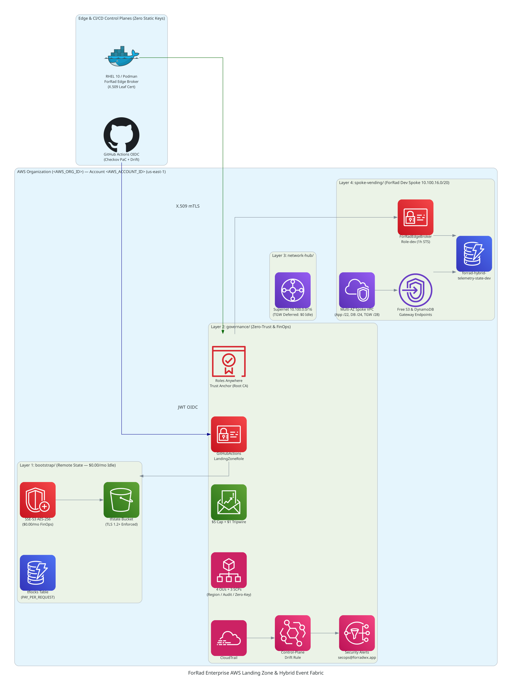
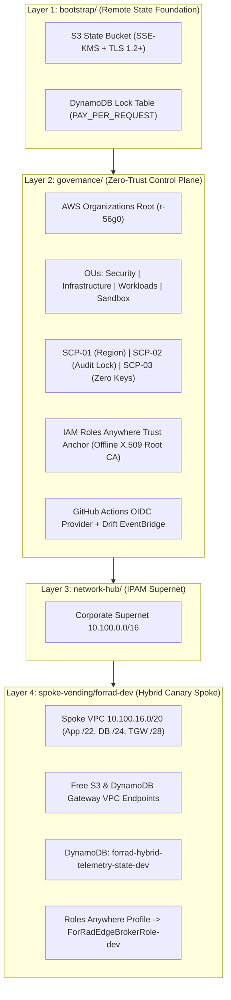

# Enterprise AWS Landing Zone & Hybrid Distributed Event Fabric (ForRad)

Production-grade, multi-account AWS Landing Zone and Hybrid Edge Foundation engineered with **Terraform**, **AWS Organizations (SCPs)**, **AWS IAM Roles Anywhere (X.509 mTLS)**, and **Shift-Left Policy-as-Code (Checkov + GitHub OIDC)**.

## 1. Architecture & State Blast-Radius Isolation

## 2. FinOps Zero-Idle Cost Ledger (< $1.50/Month Baseline)

| Architectural Layer | Prohibited Cloud Cost Trap | Avoided Cost | Implemented Zero-Idle Pattern | Idle Run-Cost |
| :--- | :--- | :--- | :--- | :--- |
| **1. Bootstrap** | Unencrypted Local State | N/A | S3 SSE-KMS + `PAY_PER_REQUEST` DynamoDB Lock | **~$0.85 / mo** |
| **2. Governance** | AWS Private CA ($400/mo) | $400.00 / mo | Offline X.509 Root CA + IAM Roles Anywhere Anchor | **$0.00 / mo** |
| **3. Network Hub** | Idle TGW Attachments | $36.00 / mo | Pre-staged `/28` TGW subnets (`enable_tgw_attachment = false`) | **$0.00 / mo** |
| **4. Spoke (Dev)** | NAT Gateways & ALBs | $85.00+ / mo | VPC Gateway Endpoints + `PAY_PER_REQUEST` DynamoDB | **$0.00 / mo** |

## 3. Empirical Verification Artifacts
- [Phase 1 Zero-Trust X.509 mTLS & Blast-Radius Canary Proof](docs/verification/phase1_mtls_canary_proof.md)

## 4. Zero-Trust Split-Domain Edge Ingress (`forradwx.app` & `forradwx.com`)
- **Primary Telemetry Gateway (`https://forradwx.app`):** Enforces strict `.app` HSTS preload transport security, terminating public client traffic at the Cloudflare Anycast edge and routing via outbound-only `cloudflared` QUIC tunnels into the RHEL 10 `forrad-net` microservice bridge (zero open WAN firewall ports).
- **Discovery & Canonical Redirect (`https://forradwx.com`):** Executes an edge-level HTTP `301 Moved Permanently` redirect to `https://forradwx.app` to preserve single-origin CORS pinning and cache locality.
