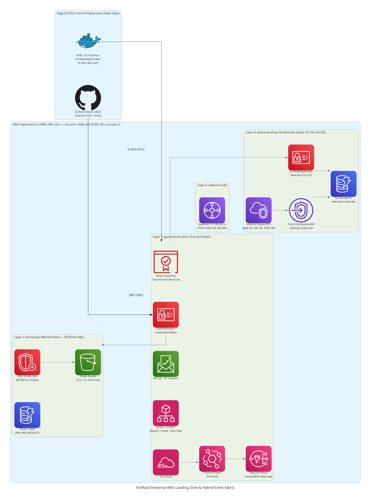
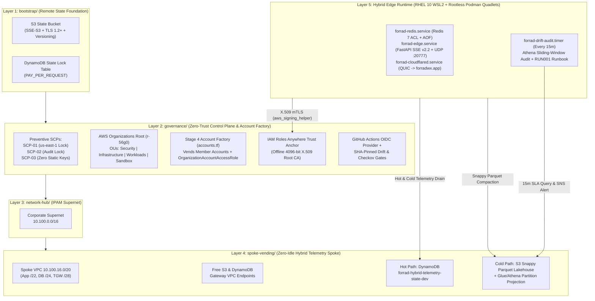

# Enterprise AWS Landing Zone & Hybrid Distributed Event Fabric (ForRad)

Production-grade, multi-account AWS Landing Zone and Hybrid Edge Telemetry Fabric engineered with **Terraform**, **AWS Organizations (SCPs & Stage 4 Account Factory)**, **AWS IAM Roles Anywhere (X.509 mTLS)**, **Rootless Podman Systemd Quadlets**, and **SHA-Pinned Shift-Left Policy-as-Code (Checkov + GitHub OIDC)**.

* **Live Production Tactical HUD:** [https://forradwx.app](https://forradwx.app)
* **Current Release Baseline:** `v0.6.0-stage4-account-factory`

---

## 1. Architecture & State Blast-Radius Isolation





---

## 2. FinOps Zero-Idle Cost Ledger (< $1.50/Month Cap | $0.03 MTD Actual)

| Architectural Layer | Prohibited Cloud Cost Trap | Avoided Cost | Implemented Zero-Idle Pattern | Idle Run-Cost |
| :--- | :--- | :--- | :--- | :--- |
| **1. Bootstrap (`bootstrap/`)** | Unencrypted Local State / Idle KMS CMKs | `$1.00+ / mo` | S3 Versioning + TLS 1.2+ + `PAY_PER_REQUEST` DynamoDB Lock | **~$0.03 / mo** |
| **2. Governance & Account Factory (`governance/`)** | AWS Private CA (`$400/mo`) & Paid Control Plane Add-ons | `$400.00 / mo` | Offline X.509 Root CA + IAM Roles Anywhere + Organizations Account Factory (`accounts.tf`) | **$0.00 / mo** |
| **3. Network Hub (`network-hub/`)** | Idle Transit Gateway Attachments | `$36.00 / mo` | Pre-staged `/28` TGW Subnets (`enable_tgw_attachment = false`) | **$0.00 / mo** |
| **4. Spoke & Lakehouse (`spoke-vending/`)** | Managed NAT Gateways (`$32/mo`) & ALBs (`$16/mo`) | `$85.00+ / mo` | S3/DynamoDB Gateway VPC Endpoints + `PAY_PER_REQUEST` DynamoDB + S3 Snappy Parquet + Athena Projection | **$0.00 / mo** |
| **5. Hybrid Edge & CI/CD (`edge-broker/`, `deploy/quadlets/`)** | Always-On Cloud Compute (ECS/EC2) & Static IAM Keys | `$35.00+ / mo` | Rootless Podman Quadlets + Cloudflare Anycast QUIC Tunnel + 15m Systemd Drift Timer + GitHub OIDC | **$0.00 / mo** |

---

## 3. Empirical Verification Artifacts & Operational Runbooks

* [Architecture Decision Records (ADRs)](docs/)
* [Phase 1: Zero-Trust X.509 mTLS & Blast-Radius Canary Proof](docs/verification/phase1_mtls_canary_proof.md)
* [Phase 2B: Queue-First Redis Streams Backplane & Silent-Failure Guardrails Proof](docs/verification/phase2b_redis_streams_proof.md)
* [Phase 3.2: Edge Caching, CI/CD Secret Injection, & Zero-Drift Validation Proof](docs/verification/phase3_2_edge_cache_proof.md)
* [Phase 4 & 5: Cloudflare Anycast QUIC Ingress, HSTS Preload, & SSE Anti-Buffering Proof](docs/verification/phase4_production_ingress_proof.md)
* [Phase 3 Track A: S3 Snappy Parquet Cold Lakehouse & Athena Partition Projection Proof](docs/verification/sprint2_track_a_lakehouse_proof.md)
* [Phase 3 Track B: FastAPI Multiplexed SSE Broadcaster & Last-Event-ID Replay Proof](docs/verification/sprint2_track_b_sse_proof.md)
* [Phase 3 Track C: Closed-Loop Golden Storm Athena Drift Detector & SNS Andon Proof](docs/verification/sprint3_drift_engine_proof.md)
* [Operational Incident Runbook: `RUN001-drift-remediation.md` (`OPS07-BP03`)](docs/runbooks/RUN001-drift-remediation.md)

---

## 4. Zero-Trust Split-Domain Edge Ingress (`forradwx.app` & `forradwx.com`)

* **Primary Telemetry Gateway ([https://forradwx.app](https://forradwx.app)):** Enforces strict `.app` HSTS preload transport security, terminating public client traffic at the Cloudflare Anycast edge and routing via outbound-only `cloudflared` QUIC tunnels into the local rootless Podman `forrad-edge` broker (`X-Accel-Buffering: no`, `<1ms` SSE preamble flush, and 15-second keepalive heartbeats with zero open WAN firewall ports).
* **Discovery & Canonical Redirect (`https://forradwx.com`):** Executes an edge-level `HTTP 301 Moved Permanently` redirect to `https://forradwx.app` to preserve single-origin CORS pinning and cache locality.

---

## 5. Stage 4 Multi-Account Vending Factory (`governance/accounts.tf`)

Member accounts (`forrad-log-archive`, `forrad-security-tooling`, `forrad-network-hub`, `forrad-workloads-prod`) are codified in `governance/accounts.tf` (`SEC01-BP01`, `SEC01-BP02`, `REL01-BP03`) with `default = {}` to preserve zero cloud drift during hold periods. To preview or vend a member account into its target OU with serialized control-plane safety (`-parallelism=1`):

```bash
terraform -chdir=governance plan -parallelism=1 \
  -var='vended_accounts={"workloads_prod":{"name":"forrad-workloads-prod","email":"admin+forrad-prod@forradwx.com","ou_key":"workloads","environment":"prod"}}'
```
