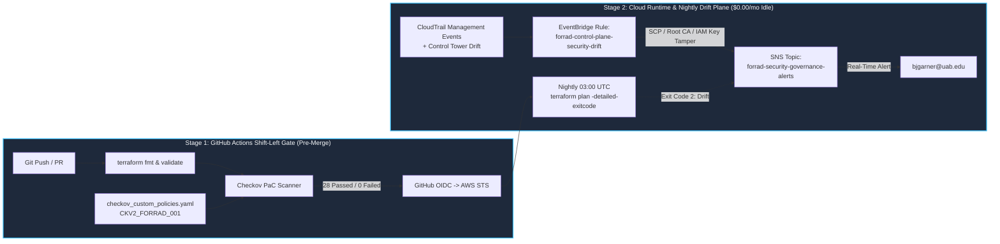

# Phase 1 Canary Verification: Zero-Trust X.509 mTLS & Blast-Radius Containment

## 1. X.509 Certificate Metadata (Offline Root CA -> Edge Leaf)
- **Subject:** `C=US, ST=AL, O=ForRad Platform, OU=HDEF Edge, CN=forrad-edge-broker-01`
- **Issuer:** `C=US, ST=AL, O=ForRad Platform, OU=Security, CN=ForRad Hybrid Root CA`
- **Hex Serial Number:** `5671F7539479BA3B31E2FEA3DEF4A0240C08ED6A`
- **X.509v3 Constraints:** `CA:FALSE`, `Digital Signature`, `TLS Web Client Authentication`

## 2. IAM Roles Anywhere mTLS Token Exchange (Zero Static IAM Keys)
- **Trust Anchor ARN:** `arn:aws:rolesanywhere:us-east-1:052535487590:trust-anchor/8d90dec1-80e8-44f8-ab30-594429b37dd7`
- **Profile ARN:** `arn:aws:rolesanywhere:us-east-1:052535487590:profile/07b24293-067f-433f-966e-7119f30ada45`
- **Assumed STS Principal:** `arn:aws:sts::052535487590:assumed-role/ForRadEdgeBrokerRole-dev/5671f7539479ba3b31e2fea3def4a0240c08ed6a`

## 3. Data-Plane Positive & Negative Boundary Results
| Test Case | Target Resource | API Action | Result |
| :--- | :--- | :--- | :--- |
| **Positive Telemetry Write/Read** | `forrad-hybrid-telemetry-state-dev` | `dynamodb:PutItem` / `GetItem` (`KBMX`) | **PASS** (`SYNCED_VIA_ROLES_ANYWHERE_MTLS`) |
| **Negative State Lock Scan** | `corp-platform-tflocks` | `dynamodb:Scan` | **BLOCKED** (`AccessDeniedException`) |
| **Negative State Bucket Enumeration** | `s3://corp-platform-tfstate-*` | `s3:ListAllMyBuckets` | **BLOCKED** (`AccessDenied`) |

## 4. End-to-End Shift-Left PaC & Runtime Drift Architecture

- **OIDC Provider ARN:** `arn:aws:iam::052535487590:oidc-provider/token.actions.githubusercontent.com`
- **Assumed CI/CD Role:** `arn:aws:iam::052535487590:role/GitHubActionsLandingZoneRole`
- **Immutable Subject Claim Prefix:** `repo:mozjack2310@16676098/aws_landing_zone@1420253933:*`
- **Shift-Left PaC Gate (`shift-left-pac.yml`):** **PASS** (28 Passed, 0 Failed, 1 FinOps Audited Skip)
- **Parallel State Drift Audit (`drift-detection.yml` Run `38775158022`):**
  - `bootstrap`: **PASS / IN_SYNC** (17s)
  - `network-hub`: **PASS / IN_SYNC** (16s)
  - `spoke-vending`: **PASS / IN_SYNC** (23s)
  - `governance`: **PASS / IN_SYNC** (24s)
